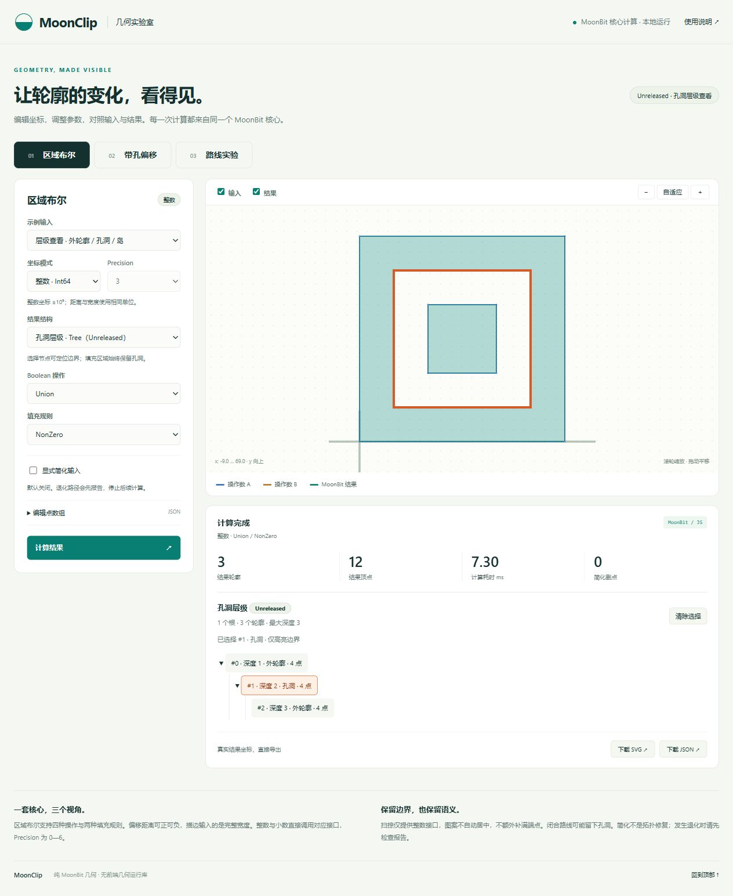
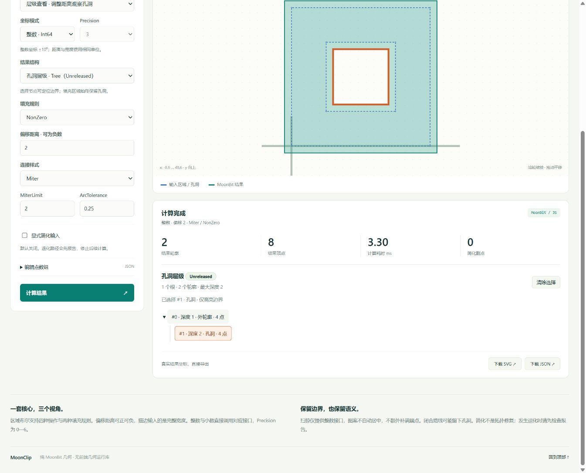
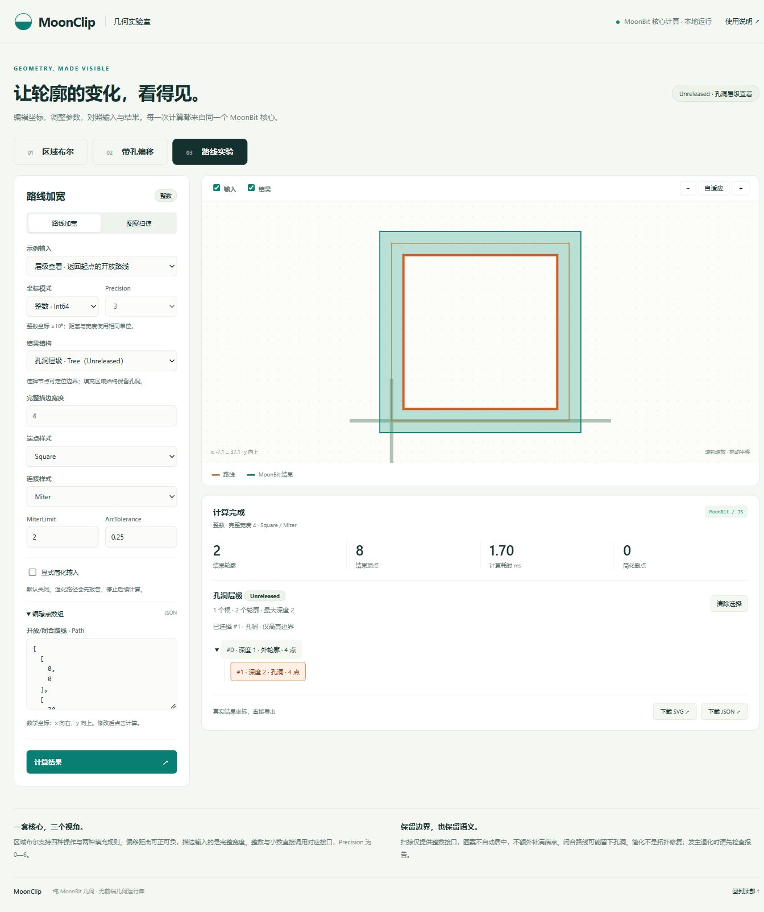
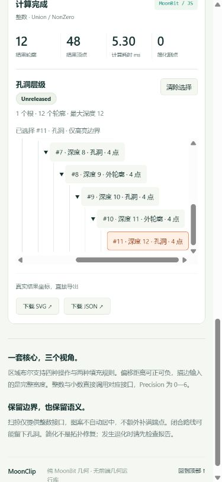

# Commit17 浏览器与导出验收

2026-10-19，Windows，本机Edge156.0.4314.30，通过已启动的http://127.0.0.1:4173实际执行页面交互。内置浏览器运行时路径异常，改用现成Edge与工具自带浏览器操作能力；未向项目添加浏览器测试框架或依赖。截图已逐张查看，并查看390×844窄屏及重新打开的SVG。

| 操作 | 实际结果 |
| --- | --- |
| Boolean切换孔洞案例、修改Union/NonZero、查看并导出 | 成功，2条结果轮廓；SVG/JSON可下载 |
| Offset切换凹形再切回带孔案例，delta7、Round、ArcTolerance0.2 | 成功，2条轮廓保留孔洞；SVG/JSON可下载 |
| Stroke切换返回起点案例，完整宽度12、Round端点、Square连接 | 成功，2条结果轮廓；SVG/JSON可下载 |
| 重开导出的offset.svg | 通过HTTP重新打开；viewBox有效，NonZero填充，孔洞可见 |
| 解析三场景与小数/扫掠导出JSON | 包含原输入、参数、精度、真实结果和简化统计 |
| Boolean小数输入 | Precision2保留小数，另抽查0和6成功 |
| Offset小数+Closed简化 | Precision2，delta2.5，删除1个共线点后计算成功 |
| Stroke小数 | Precision3，完整宽度6.25，成功 |
| Stroke显式Open简化 | 四点直线删2点，报告与结果可见 |
| 单点简化退化 | 三类报告保留，后续计算停止，SVG/JSON导出禁用 |
| Offset的MiterLimit1 | 库InvalidInput显示；有效结果清空，两导出禁用；改回2恢复 |
| 点数组输入[1,2] | 结构化输入错误，无未处理异常 |
| 扫掠选择偏置图案与闭合矩形路线 | 仅整数，精度控件禁用；2条轮廓含孔洞，可导出 |
| 显隐、缩放、自适应 | 正常，视图范围实际变化 |
| 390×844窄屏 | 单列，无横向溢出，控件与结果可用 |
| 静态包dist/index.html通过HTTP打开 | 真实计算成功，导出可用，无页面异常 |
| 页面错误与浏览器控制台 | 0个未处理异常/console.error |

三张主要场景截图位于docs/demo-screenshots。导出原件和详细操作记录保留在本地忽略目录demo/.qa与_build/demo-qa；仓库只保存简短记录及三张截图。截图计时不作为性能基准。

桥接冒烟：7/7通过，覆盖真实整数Boolean、带孔Offset、完整宽度Stroke、固定Minkowski短路线参考、小数三类入口、简化删点/退化阻断、结构化错误及导出结构。没有新增库测试或参考案例。本地未额外运行2234项整套库测试，未触发独立参考重建；普通Linux CI在最终提交上执行完整回归和演示构建/冒烟，远端结果单独核对。

# Commit 23 孔洞层级查看与结构导出验收

2026-10-20，Windows，通过 Codex 内置浏览器实际访问已启动的 `http://127.0.0.1:4173/`。沿用既有页面、Worker 和 Node 冒烟，没有增加浏览器测试框架或 npm 依赖。桌面与 390×844 窄屏分别检查，截图逐张查看；截图中的单次耗时不作为性能结论。

| 操作 | 实际结果 |
| --- | --- |
| 默认场景与平铺导出 | 原有平铺默认值保留，版本 1 JSON 结构通过冒烟核对 |
| Boolean 层级示例 | 1 根、3 轮廓、最大深度 3；外轮廓／孔洞／岛完整显示，选择孔洞或岛只高亮对应边界 |
| 展开、收起与清除选择 | 子节点可收起后展开，清除后无高亮；节点编号与当前响应的 paths 索引一致 |
| Offset 孔洞随参数变化 | delta=2 有两层；改为 10 后孔洞消失，变为一层；编辑参数立即清除旧树和选择并禁用导出 |
| Stroke 返回起点的开放路线 | 完整宽度 4，Miter／Square，外边界 [-2,-2]—[32,32]，孔洞 [2,2]—[28,28]，树为两层；完整坐标由桥接冒烟独立断言 |
| 三场景整数与小数树 | 六个核心入口均执行，Boolean／Stroke Precision=3，Offset 另检查 0 和 6；冒烟还用真实小数坐标核对完整轮廓 |
| 小数描边零宽度 | 成功空树，根数／轮廓数／最大深度均为 0，没有可选择节点，允许导出有效空结果 |
| 小数 Offset 的 MiterLimit=1 | 显示核心 InvalidInput / DecimalParameters，树、结果和选择清空，导出禁用；改回 2 可恢复 |
| Stroke 单点启用显式简化 | 显示 DegenerateAfterSimplification / SimplifyReport 及原退化索引，不运行后续几何，不导出部分树 |
| 较大请求后立即编辑 | 对 500 个矩形发起请求后将输入改为空；稍后仍处于“输入已更新 · 待计算”，旧响应未恢复树或导出；手动重算得到空树 |
| 切到图案扫掠 | 输出重置为 paths 且控件禁用，旧树与高亮清空；只运行整数平铺 |
| 实际下载 JSON | Boolean、Offset、Stroke 下载原件可解析为 MoonClipDemo v2，保存 request.version=1、result.paths、output、mode、precision 和完整 tree；三份实际下载文件已重放核对，自动测试另核对深复制 |
| 实际下载 SVG 后通过 HTTP 重开 | 单个 NonZero 复合 path，三条轮廓保留孔洞与岛，viewBox 有效，不含输入层或选择高亮；已目视检查 |
| 390×844 及长层级列表 | 单列布局，页面无横向溢出；12 层列表可滚动到末节点并选择，树摘要与高亮保留 |
| 静态包 dist/index.html 通过 HTTP 打开 | 构建产物运行三层 Boolean 树成功，独立 Worker 和模块正常加载 |
| 控制台 | 本次页面捕获的 error／warn 日志为 0 |

当前桥接／导出冒烟 **20/20**：保留原有 7 项，新增 13 项，包括六个树分支、空结果、多根和 12 层索引对齐、错误、显式简化、版本 2 重放与复制隔离及 SVG。`moon info`、`moon fmt`、JS deny-warn 检查、静态构建和 diff 检查通过。未在本地重复运行库全量、旧参考重建、性能测量或赛事提交。最终 SHA 的普通 Linux CI 另执行完整回归、演示构建／20 项冒烟、基准冒烟及候选消费者，其实际结果以该 SHA 的 Actions 日志为准。

库测试仍为 native／JS 各 **2323**，既有 **1384 个参考案例、2276 项能力检查**与根公开接口未变。本次没有新增上游对照矩阵，演示扩展属于 **Unreleased**。

截图保留在 `docs/demo-screenshots/tree-boolean.jpg`、`tree-offset.jpg`、`tree-stroke.jpg` 和 `tree-narrow.jpg`。实际下载 JSON、SVG 和验收收据位于本地忽略目录 `_build/commit23/`；SVG 的 HTTP 重开副本在 `demo/.qa/`。历史 Commit 17 的截图和记录保持原样。

