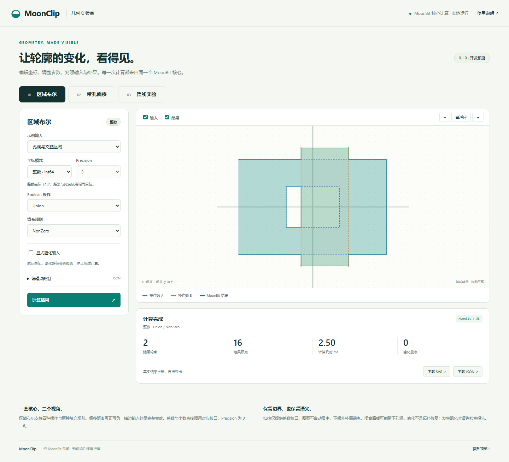
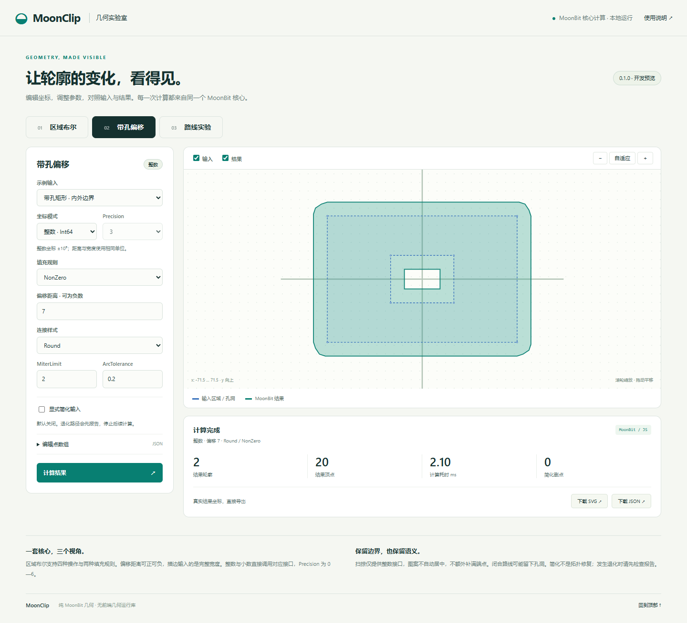
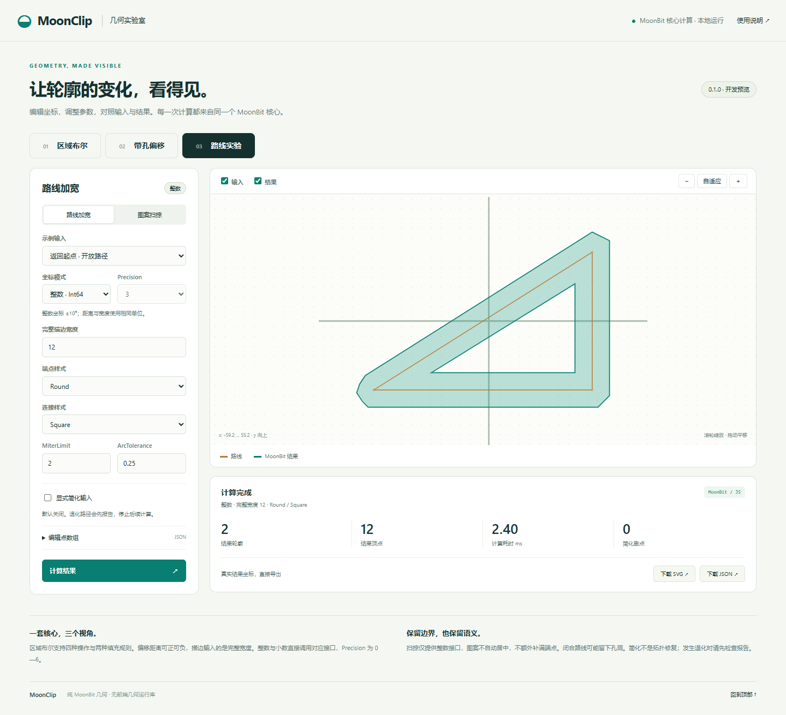

# MoonClip 交互演示

## 本地启动与静态构建

使用项目固定MoonBit工具链与Node.js20以上。本机验证Node.js24.18.0；没有npm依赖，不需要npm install。Windows的npm脚本使用已安装Git Bash，Linux使用bash。

```bash
cd demo
npm run dev
```

dev只构建cmd/demo所需JS，并在127.0.0.1:4173启动HTTP服务。先启动再打开网址，不使用file://。无热更新；修改网页文件后刷新，修改MoonBit桥接后运行bash scripts/build_demo.sh再刷新（在根目录运行）。静态文件通过相对地址加载ES模块和worker，同源HTTP/HTTPS托管即可。

```bash
# 另一个终端，demo目录；复用已编译产物
npm test
npm run build -- --reuse
# 干净检出或需要重新编译
npm run build
```

build生成demo/dist，包含HTML、CSS、案例输入、界面/导出/worker脚本和MoonBit JS。dist、generated、node_modules及本地.qa导出材料均被忽略，不提交编译JS。build_demo.sh可从任意调用目录运行，只构建JS桥接包，不运行整套库测试。npm test仅执行7项桥接/导出冒烟，不增加几何对照矩阵。

## 场景与参数

| 场景 | 输入与参数 | 坐标模式 |
| --- | --- | --- |
| 区域Boolean | 两组有序轮廓；Intersection/Union/Difference/Xor；EvenOdd/NonZero | 整数或小数 |
| 带孔偏移 | 轮廓及孔洞；有符号delta；四种Join；MiterLimit；ArcTolerance | 整数或小数 |
| 路线加宽 | 单条开放路线；完整width；Butt/Square/Round端点；四种Join | 整数或小数 |
| 图案扫掠 | 一个整数图案、一条路线；显式开闭；图案直接相加 | 仅整数 |

整数坐标要求合法JSON整数，桥接只接受可精确表示的安全整数，之后由库检查几何范围±10^9；小数直接构造PointD并传入Precision0—6。没有前端自行缩放的小数扫掠。距离、完整宽度、正ArcTolerance及epsilon都使用当前输入坐标的原始单位；MiterLimit无量纲且至少2，ArcTolerance0保留库的自动策略。允许负偏移，参数错误原样显示库错误和位置。

案例文件只含输入与参数，取材于已有矩形、孔洞、凹轮廓、折线和整数图案构型，不链接参考预期作为结果。点数组编辑器：Boolean/Offset为Paths（多层数组），Stroke/Minkowski路线为Path，图案也为Path。闭合轮廓一般不重复首点；路线末尾返回首点不替代扫掠的显式闭合开关。

图形按数学坐标系显示，x向右、y向上。蓝色为输入区域/操作数A，橙色为操作数B或路线，紫色为局部图案及原点十字，绿色为真实结果。扫掠图案绘于局部原点，路线各顶点对应平移位置；偏置图案不会自动居中。可显隐输入/结果、自适应、按钮/滚轮缩放、拖动平移。绘制通过SVG坐标变换处理y轴，不改变核心语义。结果按NonZero复合路径绘制孔洞。

## 显式简化与失败

简化默认关闭。开启时Boolean与Offset调用Closed，Stroke调用Open。Boolean的报告路径索引先排列全部subject，再排列全部clip。显示removed_vertices、removed_per_path及input_degenerate_indices、degenerate_indices、collapsed_indices。

三类退化列表任一非空时，先显示报告并停止后续计算；不补点、不删除路径、不自动过滤。简化不是拓扑修复。Minkowski不隐式简化，切到扫掠时关闭简化开关。

worker调用同一MoonBit编译产物，界面不实现Boolean、Offset、Stroke、Simplify或Minkowski。JSON解析/类型错误与库错误分开返回，库错误保留kind、stage、path_index、vertex_index及适用的轴/值/资源/关联位置。输入编辑立即失效结果，旧请求的迟到响应按请求编号丢弃；失败后无结果层且两个导出按钮禁用。修正后必须重新计算。

## 导出与复现

SVG只导出当前有效结果，包含独立viewBox、白色背景、数学坐标变换与NonZero填充，孔洞保持为空；不需要外部字体、样式或脚本。坐标来自真实结果数组。

JSON格式为MoonClipDemo版本1，包含kernel、完整原始request（场景、两操作数/路线/图案、模式、参数、precision、简化选项）、result.paths及simplification统计。可把导出的request再次传给compute复现；结果不从SVG字符串或像素反推。整数结果precision为null；request中的precision在整数模式下不参与量化。

图案扫掠不额外补满完整端点图案，短路线可留空隙，闭合路线可留孔洞。无开放Boolean、MinkowskiDiff、小数扫掠、带孔图案集合或多轮廓描边的新接口。页面显示的耗时仅为worker内单次桥接调用时长，不是基准性能结论。

不依赖浏览器的同类公开调用保留在cmd/example/main.mbt：moon run --target native cmd/example。

## 实际场景截图






