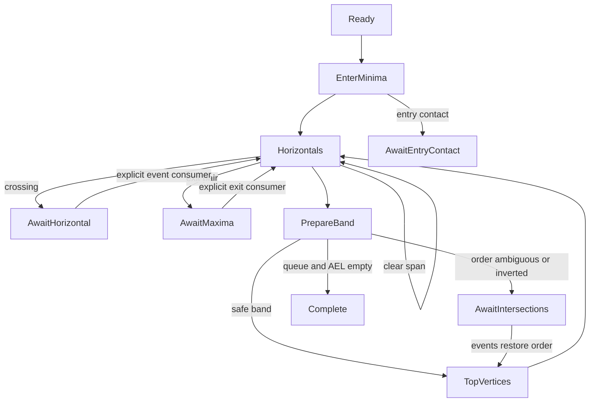

# 内部扫描线与活动边基础（Commit 4）

本笔交付可独立测试的事件调度、边界链、活动边生命周期和共享预算，不提供布尔运算接口。交点、水平重叠、输出节点和轮廓连接仍由 Commit 5 接入；136 个参考案例继续是 reference_only。

## 坐标与内部扫描次序

公开坐标系保持 x 向右、y 向上，正有向面积/叉积为逆时针。内部扫描沿固定 Clipper2 路线，从较大 y 到较小 y。这里的 bot 是当前边段数值较大的 y 端点，top 是数值较小的 y 端点；水平边两端 y 相等。名字不改变公开方向约定，也不把显示坐标轴引入几何谓词。

## 快照、顶点和边界链

`prepare_scan(subject, clip, limits=...)` 是私有组件入口。两个操作数共用现有 Limits 中的原始路径、顶点额度，并在建立内部顶点前检查全部坐标。Clip 的错误路径索引接在 Subject 之后；SourceId 另保留角色、角色内路径索引及原始顶点索引。

预检本身计入工作量。创建结果数组前先计算整理后的顶点数量和预检额度，再调用 Commit 2 的 `normalize_validated(..., Closed)`；扫描原输入建立准确的来源映射，不用整理后的下标冒充原始下标。Point64 不可变，顶点数组、索引数组和扫描状态均不与调用者共享可变存储。

每条路径保存 raw_count、角色、路径索引和顶点索引序列；Vertex 用 prev/next 索引表达闭合关系，无效引用统一为 None。空路径、单点、两点和全水平轮廓保留快照、来源和计数，但不创建面域扫描事件。其他轮廓不以有向面积为零过滤，因此蝴蝶形仍有可扫描边界。

从一个高度变化处开始，按顶点顺序把连续同高度顶点分组，一圈内每组只处理一次，水平链跨首尾接缝也属于同组。平台 y 大于两侧非水平邻点时登记一次 LocalMinima（内部进入点），小于两侧时标记退出平台。全水平输入在分组前结束，不进行无界寻找。

每个进入点有两个 BoundaryChain，分别沿原图 next（direction=+1）和 prev（direction=-1）推进，不反转输入。向前链在退出平台的首顶点结束；向后链负责退出平台的水平段，最终结束于同一个规范退出锚点。链保存 LocalMinima 身份、原始方向、顶点索引及 left_bound。创建关联的两条链或两条活动边前预检二者所需额度。

## 高度与阶段

最大堆保存高度，membership set 去重，Map 保存同高度全部进入事件。插入/移除高度为 O(log H)，去重查找为期望 O(1)；初始插入 M 个极值为 O(M log H)，不在每次出队时重新排序顶点。扫描过程中非水平新边段会登记自己的 top.y。取出的高度严格递减，零高度是普通值，空队列返回 None。

| 阶段 | 已实现的行为与出口 |
| --- | --- |
| Ready | 取出首高度或结束空扫描 |
| EnterMinima | 处理该高度全部进入事件，申请并插入两侧边界，登记水平边/下一端点 |
| Horizontals | 取出一个水平事件，记录左右方向及跨度；无交叉时推进真实边段，反向折返造成自重叠或遇到其他候选边时保留 held 句柄并暂停 |
| PrepareBand | 建立独立 SEL 快照，检查带顶投影顺序，确认安全后推进；否则暂停 |
| AwaitEntryContact(vertex,a,b) | 保留新进入顶点及接触边句柄，等待进入接触的拓扑事件；本笔没有自动放行入口 |
| AwaitIntersections(y) | 保留原 AEL 和带顶高度；未处理交点前不重排或推进 |
| TopVertices | 推进到达端点的边段，登记水平转接、下一高度或退出状态 |
| AwaitHorizontal(id) | 保留当前水平事件，等待 Commit 5 处理穿越、相切或输出连接 |
| AwaitMaxima(vertex,a,b) | 保留退出锚点和配对句柄，等待显式消费退出事件 |
| Complete / Failed | 扫描状态生命周期结束 / 明确终止；不代表布尔输出已经构造 |

顶部事件产生的水平段、退出配对处理完后，才进入该高度的新进入事件。新进入顶点在当前投影上接触已有边时，另保留 AwaitEntryContact；它也可能是网格投影下的保守候选，等待后续精确事件处理。`scan_step` 每次执行一个真实阶段；Await 状态不自动接受未实现的事件。带顶投影相等且不能确认为共同退出点时，保守暂停，不能据此宣称已经找出全部精确交点。

白盒测试可提交人工相邻交换，再调用 `commit_band`；未恢复带顶顺序的提交会失败。`commit_horizontal` 是可信事件消费者边界，自动驱动只在跨度没有其他候选边时调用，不能作为完整水平拓扑处理。`commit_maxima` 要求匹配的相邻退出对，先保留不可变的顶点/链来源记录，再解除引用并释放槽位。测试中的无交叉完整推进明确消费这些退出事件，没有输出合并占位函数。

## 投影、插入与顺序

几何符号统一使用经过范围证明的整数行列式。非水平投影遵循固定上游 TopX：端点、垂直边直接返回 x，其余先 ties-to-even 舍入 `dx*(y-bot.y)`，再用 Int64 加上 bot.x。水平边用 ToLeft/ToRight 状态处理，不用无穷值代替方向。详细规则见 [numerics.md](numerics.md)。

`edge_position_compare` 是普通位置/精确方向比较；`resident_before_new` 是依赖当前进入状态的插入谓词，两者用途不同。插入先比较投影 x，相同时检查精确转向，再沿后续共线边段寻找真实转向、区分左右边界及另一侧边界方向，最后才按输入路径、原始进入顶点和方向作稳定区分。稳定键从不使用可复用的槽位号。

AEL 按链插入，插入查找最坏 O(A)，大量同高度输入可能产生 O(A²) 总工作量，受共享预算明确约束。状态相关谓词不用于通用排序。跨扫描带发现顺序倒置时保存待处理状态，不直接排序 AEL 跳过交点。SEL 是独立的双向快照，AEL 的相邻交换不改变 SEL；没有伪装完成交点的自动重排。

## 槽位与不变量

EdgeId 为 `(slot,generation)`，槽位数组扩容不改变索引。申请、初始化、释放、复用经统一入口；复用创建完整新 ActiveEdge，清除 AEL/SEL、水平队列、退出、游标等旧状态。释放要求从两条链、水平事件和待处理阶段解除所有引用，并递增 generation；旧句柄不能操作新记录。句柄只在所属 ScanState 内有效，不跨独立调用传递。

支持空链、头部、中间、尾部的插入/移除，以及相邻交换。非相邻交换、重复插入、失效句柄、提前移除待处理水平边、未到端点时推进均明确失败，不返回假成功。AEL 和 SEL 各自维护 prev/next 和成员标记。

只读 `scan_invariants` 检查顶点归属、原始来源、闭合邻接、链方向、有效代次、成员可达性、双向链接、环、重复节点、空闲槽位、待处理事件及计数。稳定阶段另检查当前 x 非递减、两侧边界方向增量总和为零。诊断受已分配顶点/槽位数量约束，故可在预算失败后使用，不会修改执行统计。测试故意破坏链接、制造环或失效句柄，确认检查器会拒绝。

## 内部预算与统计

公开 Limits 保留原有两个字段及构造方式。私有 ScanLimits 包装 input: Limits，新增实际使用的 max_nodes（默认 500,000）、max_work（默认 5,000,000）。负限制无效，零额度合法；错误复用 ClipError、原始位置和英文说明。公开 ResourceKind 新增 InternalNodes、ScanWork，Stage 新增对应内部准备与扫描阶段；没有公开引擎类型或调试入口。

节点额度是累计逻辑创建次数：路径记录、顶点、进入/退出平台、进入索引、边界链、活动边、首次登记的高度、水平事件、进入接触事件和消费后的退出来源记录。索引向量的存储受这些记录及工作量上界约束；计数不是物理内存字节数。槽位复用不退款，峰值另行记录。

工作量按以下明确操作收费：路径/原始坐标预检、整理计数、预付重复点整理遍历、来源映射、闭合链接、平台扫描、链步进、堆上滤/下滤、链查找/比较、后续转向查找、水平范围扫描、投影、辅助链复制/清理和阶段推进。所有随输入增长的算法循环都逐步收费或预付已知遍历长度，不在每条路径或每个高度重置。Map/Set 以标准库原语计费；这是算法工作量保护，不是执行时间或内存性能保证。

超限发生在创建或扩大逻辑容器之前；计数通过剩余额度比较，避免累加溢出。比较预算耗尽抛出私有 ScanAbort，并在组件入口转成 Result 错误，不把失败当作相等继续。状态记录失败并进入 Failed，后续调用保持错误。下一次 prepare_scan 新建上下文。清理仅遍历已分配槽位、清空持有引用，不申请新节点或恢复预算；因此耗尽预算后仍能安全结束。

内部统计保留累计节点/工作量、活动边峰值、处理高度数、活动边比较次数和水平链推进次数。私有组件尚未接入公开布尔入口，其入口及白盒诊断派生使用局部 unused_value 标记；没有关闭其他告警，native/JS 均继续使用 --deny-warn。

## 当前验证

保留 Commit 3 的 71 项库回归，新增 57 项白盒测试，共 128 项，在 native 和 JS 使用相同输入、明确预期分别运行。覆盖极值和接缝、退化路径、自交暂停、高度去重、水平/非水平转接、半整数舍入、共线后续转向、来源排序、槽位代次、坏链、精确额度和少一单位失败、多轮廓/多阶段累计、失败清理与独立重复调用。

扫描状态测试不等于布尔兼容性测试；填充规则、交点构造、水平重叠、输出连接和完整布尔结果尚未接入。
