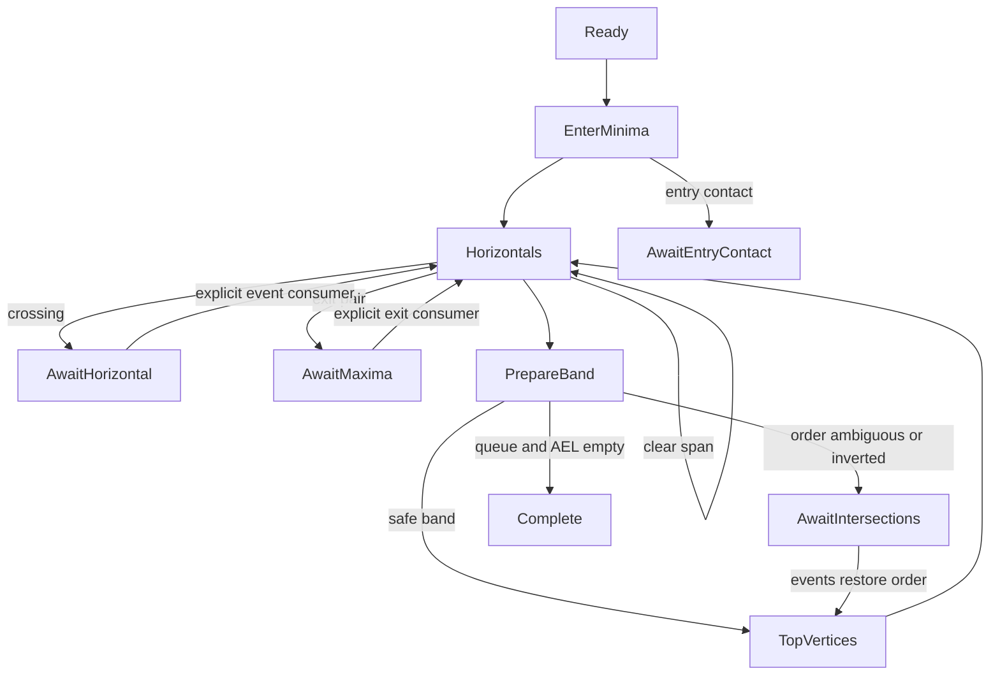

# 扫描线、输出连接与 EvenOdd 布尔运算（Commit 4–6）

内部引擎已接通扫描、交点、水平交互和输出连接；Commit 7 完成带符号绕数，Commit 8 提供平铺与 PolyTree 两种独立入口。公开 EvenOdd/NonZero 各 76 案例分别验证路径和树，私有 Positive/Negative 各 24 案例也分别验证；当前每目标 659 项回归。下文保留各提交阶段的实现记录，当前归属与预算契约见 Commit 8 节。

## 坐标与内部扫描次序

公开坐标系保持 x 向右、y 向上，正有向面积/叉积为逆时针。内部扫描沿固定 Clipper2 路线，从较大 y 到较小 y。这里的 bot 是当前边段数值较大的 y 端点，top 是数值较小的 y 端点；水平边两端 y 相等。名字不改变公开方向约定，也不把显示坐标轴引入几何谓词。

## 快照、顶点和边界链

`prepare_scan(subject, clip, limits=...)` 是私有组件入口。两个操作数共用现有 Limits 中的原始路径、顶点额度，并在建立内部顶点前检查全部坐标。Clip 的错误路径索引接在 Subject 之后；SourceId 另保留角色、角色内路径索引及原始顶点索引。

预检本身计入工作量。创建结果数组前先计算整理后的顶点数量和预检额度，再调用 Commit 2 的 `normalize_validated(..., Closed)`；扫描原输入建立准确的来源映射，不用整理后的下标冒充原始下标。Point64 不可变，顶点数组、索引数组和扫描状态均不与调用者共享可变存储。

每条路径保存 raw_count、角色、路径索引和顶点索引序列；Vertex 用 prev/next 索引表达闭合关系，无效引用统一为 None。空路径、单点、两点和全水平轮廓保留快照、来源和计数，但不创建面域扫描事件。其他轮廓不以有向面积为零过滤，因此蝴蝶形仍有可扫描边界。

从一个高度变化处开始，按顶点顺序把连续同高度顶点分组，一圈内每组只处理一次，水平链跨首尾接缝也属于同组。平台 y 大于两侧非水平邻点时登记一次 LocalMinima（内部进入点），小于两侧时标记退出平台。全水平输入在分组前结束，不进行无界寻找。

每个进入点有两个 BoundaryChain，分别沿原图 next（direction=+1）和 prev（direction=-1）推进，不反转输入。向前链在退出平台的首顶点结束；向后链负责退出平台的水平段，最终结束于同一个规范退出锚点。链保存 LocalMinima 身份、原始方向、顶点索引及 left_bound。创建关联的两条链或两条活动边前预检二者所需额度。

## Commit 4 低层高度与阶段

最大堆保存高度，membership set 去重，Map 保存同高度全部进入事件。插入/移除高度为 O(log H)，去重查找为期望 O(1)；初始插入 M 个极值为 O(M log H)，不在每次出队时重新排序顶点。扫描过程中非水平新边段会登记自己的 top.y。取出的高度严格递减，零高度是普通值，空队列返回 None。

| 阶段 | 已实现的行为与出口 |
| --- | --- |
| Ready | 取出首高度或结束空扫描 |
| EnterMinima | 处理该高度全部进入事件，申请并插入两侧边界，登记水平边/下一端点 |
| Horizontals | 取出一个水平事件，记录左右方向及跨度；无交叉时推进真实边段，反向折返造成自重叠或遇到其他候选边时保留 held 句柄并暂停 |
| PrepareBand | 建立独立 SEL 快照，检查带顶投影顺序，确认安全后推进；否则暂停 |
| AwaitEntryContact(vertex,a,b) | 保留新进入顶点及接触边句柄，等待进入接触的拓扑事件；本笔没有自动放行入口 |
| AwaitIntersections(y) | 保留原 AEL 和带顶高度；未处理交点前不重排或推进 |
| TopVertices | 推进到达端点的边段，登记水平转接、下一高度或退出状态 |
| AwaitHorizontal(id) | 保留当前水平事件，等待 Commit 5 处理穿越、相切或输出连接 |
| AwaitMaxima(vertex,a,b) | 保留退出锚点和配对句柄，等待显式消费退出事件 |
| Complete / Failed | 扫描状态生命周期结束 / 明确终止；不代表布尔输出已经构造 |

顶部事件产生的水平段、退出配对处理完后，才进入该高度的新进入事件。新进入顶点在当前投影上接触已有边时，另保留 AwaitEntryContact；它也可能是网格投影下的保守候选，等待后续精确事件处理。`scan_step` 每次执行一个真实阶段；Await 状态不自动接受未实现的事件。带顶投影相等且不能确认为共同退出点时，保守暂停，不能据此宣称已经找出全部精确交点。

白盒测试可提交人工相邻交换，再调用 `commit_band`；未恢复带顶顺序的提交会失败。`commit_horizontal` 是可信事件消费者边界，自动驱动只在跨度没有其他候选边时调用，不能作为完整水平拓扑处理。`commit_maxima` 要求匹配的相邻退出对，先保留不可变的顶点/链来源记录，再解除引用并释放槽位。测试中的无交叉完整推进明确消费这些退出事件，没有输出合并占位函数。

## 投影、插入与顺序

几何符号统一使用经过范围证明的整数行列式。非水平投影遵循固定上游 TopX：端点、垂直边直接返回 x，其余先 ties-to-even 舍入 `dx*(y-bot.y)`，再用 Int64 加上 bot.x。水平边用 ToLeft/ToRight 状态处理，不用无穷值代替方向。详细规则见 [numerics.md](numerics.md)。

`edge_position_compare` 是普通位置/精确方向比较；`resident_before_new` 是依赖当前进入状态的插入谓词，两者用途不同。插入先比较投影 x，相同时检查精确转向，再沿后续共线边段寻找真实转向、区分左右边界及另一侧边界方向，最后才按输入路径、原始进入顶点和方向作稳定区分。稳定键从不使用可复用的槽位号。

AEL 按链插入，插入查找最坏 O(A)，大量同高度输入可能产生 O(A²) 总工作量，受共享预算明确约束。状态相关谓词不用于通用排序。跨扫描带发现顺序倒置时保存待处理状态，不直接排序 AEL 跳过交点。SEL 是独立的双向快照，AEL 的相邻交换不改变 SEL；没有伪装完成交点的自动重排。

## 槽位与不变量

EdgeId 为 `(slot,generation)`，槽位数组扩容不改变索引。申请、初始化、释放、复用经统一入口；复用创建完整新 ActiveEdge，清除 AEL/SEL、水平队列、退出、游标等旧状态。释放要求从两条链、水平事件和待处理阶段解除所有引用，并递增 generation；旧句柄不能操作新记录。句柄只在所属 ScanState 内有效，不跨独立调用传递。

支持空链、头部、中间、尾部的插入/移除，以及相邻交换。非相邻交换、重复插入、失效句柄、提前移除待处理水平边、未到端点时推进均明确失败，不返回假成功。AEL 和 SEL 各自维护 prev/next 和成员标记。

只读 `scan_invariants` 检查顶点归属、原始来源、闭合邻接、链方向、有效代次、成员可达性、双向链接、环、重复节点、空闲槽位、待处理事件及计数。稳定阶段另检查当前 x 非递减、两侧边界方向增量总和为零。诊断受已分配顶点/槽位数量约束，故可在预算失败后使用，不会修改执行统计。测试故意破坏链接、制造环或失效句柄，确认检查器会拒绝。

## 内部预算与统计

公开 Limits 保留原有两个字段及构造方式。私有 ScanLimits 包装 input: Limits，新增实际使用的 max_nodes（默认 500,000）、max_work（默认 5,000,000）。负限制无效，零额度合法；错误复用 ClipError、原始位置和英文说明。公开 ResourceKind 新增 InternalNodes、ScanWork，Stage 新增对应内部准备与扫描阶段；没有公开引擎类型或调试入口。

节点额度是累计逻辑创建次数：路径记录、顶点、进入/退出平台、进入索引、边界链、活动边、首次登记的高度、水平事件、进入接触事件和消费后的退出来源记录。索引向量的存储受这些记录及工作量上界约束；计数不是物理内存字节数。槽位复用不退款，峰值另行记录。

工作量按以下明确操作收费：路径/原始坐标预检、整理计数、预付重复点整理遍历、来源映射、闭合链接、平台扫描、链步进、堆上滤/下滤、链查找/比较、后续转向查找、水平范围扫描、投影、辅助链复制/清理和阶段推进。所有随输入增长的算法循环都逐步收费或预付已知遍历长度，不在每条路径或每个高度重置。Map/Set 以标准库原语计费；这是算法工作量保护，不是执行时间或内存性能保证。

超限发生在创建或扩大逻辑容器之前；计数通过剩余额度比较，避免累加溢出。比较预算耗尽抛出私有 ScanAbort，并在组件入口转成 Result 错误，不把失败当作相等继续。状态记录失败并进入 Failed，后续调用保持错误。下一次 prepare_scan 新建上下文。清理仅遍历已分配槽位、清空持有引用，不申请新节点或恢复预算；因此耗尽预算后仍能安全结束。

内部统计保留累计节点/工作量、活动边峰值、处理高度数、活动边比较次数和水平链推进次数。Commit 4 时私有组件尚未接入公开布尔入口，其入口及白盒诊断派生使用局部 unused_value 标记；没有关闭其他告警，native/JS 均继续使用 --deny-warn。

## 当前验证

保留 Commit 3 的 71 项库回归，新增 57 项白盒测试，共 128 项，在 native 和 JS 使用相同输入、明确预期分别运行。覆盖极值和接缝、退化路径、自交暂停、高度去重、水平/非水平转接、半整数舍入、共线后续转向、来源排序、槽位代次、坏链、精确额度和少一单位失败、多轮廓/多阶段累计、失败清理与独立重复调用。

上述是 Commit 4 的原有组件基线；Commit 5 的接通方式与新增验证见下文。

## Commit 5 事件与语义入口

保留 `scan_step` 的低层边界及原有 128 项测试，新增私有 `engine_step(state, decide)` 将它们接通。回调收到实际扫描生成的 Minimum、Crossing、BandContact、EntryContact、HorizontalCrossing、Maximum，必须返回明确连接决策。Defer 保留当前事件/游标，Ignore 明确不创建输出，其他动作包括创建、继续、交换输出端、闭合/合并及闭合后再创建。没有隐含的“所有边贡献”策略。

矩形、凹形、自交蝴蝶形及水平折返的组合测试使用固定的小型决策序列。它们从输入构建扫描事件，再执行输出动作，没有把最终预期路径塞进输出环。自交点的 CloseAndStart 记录新轮廓的 split_from。回调暂缓进入事件时，队列保留全部未决连接；同点多边接触按边身份保留全部相关配对，不按坐标去重。

| Commit 4 边界 | Commit 5 接通行为 |
| --- | --- |
| AwaitIntersections | 生成事件，逐项贡献决策/输出交互，相邻交换，核对带顶目标并提交 |
| AwaitEntryContact | 逐对保留同点进入接触，显式决策后恢复；不默认交换几何关系没有反转的边 |
| AwaitHorizontal | 沿方向处理相邻边，提供交互点与输出动作，再沿真实边界链推进 |
| AwaitMaxima | 显式闭合/合并并解除输出端后消费退出事件，禁止释放仍关联输出的边 |

## 交点生成和相邻执行

对 SEL 的独立快照使用稳定的自底向上归并。按带顶整数投影比较，右侧元素跨过尚未归并的左侧元素时，为每个实际倒置边对创建事件；复杂度 O(A log A + K)，没有无条件枚举所有边对。AEL 保持原状，SEL 保存最终目标次序。

IntersectEvent 保存 slot/generation、双方 bot/top 顶点身份、带底/带顶高度、整数坐标、serial 及是否反转顺序。事件排序为 y 降序、同 y 的 x 升序，剩余并列按生成 serial 稳定区分。执行前校验带与边段身份。当前事件不相邻时，在有限的剩余列表中寻找相邻事件交换到当前处理位置，搜索逐步收费；找不到则进入 Failed。相邻性优先修序遵循固定上游，不能把排序坐标当成拓扑身份。每个真实反转事件触发输出动作后才交换 AEL，不通过整体重排跳过副作用。

带顶投影并列、不能认定为本轮廓共同退出点时，另生成不交换次序的 BandContact 候选。它表达网格接触/歧义，不能被当成已经证明的精确相交。贡献决策仍必须显式提供。带结束时，实际 AEL 必须逐项等于 SEL 目标，投影次序也须通过检查；事件和带身份随后清空，累计预算不清零。

## 水平交互与重叠候选

水平边按 ToLeft/ToRight 从当前 AEL 邻边向跨度内推进，交互点为 `(other.current_x, y)`。每次交互调用显式输出动作，再交换相邻边。自身进入配对和已经到达共同退出点的配对分别处理；水平端点与非水平边相遇时，按后续边段的 TopX 关系决定是否停止穿越。连续水平链及反向折返由 edge_advance 产生下一事件，不丢弃处理中新增的水平事件。

已贡献的实际水平输出片段保存两端 OutPtId、范围和方向。正长度重叠生成 HorizontalJoin，保留相同坐标上的两个不同节点；需要时沿现有水平弧插入重叠端点。端点接触不形成正长度连接。候选发现最坏 O(S²)，每次比较和弧查找均收费，超过共享预算明确终止。

同向和反向重叠均保存候选及 opposed 标记。执行时重新解析两节点的当前有效记录；反向候选可经明确 splice 决策在已完成环上连接，同记录拆分、不同记录合并。同向重叠需要贡献选择，不能直接 splice；显式拒绝候选后可继续分别保留轮廓。这一边界不替代 Commit 6 的填充语义。未消费的候选阻止结果提取，不能把未决重叠包装成成功输出。

## 输出环生命周期

OutPtId/OutRecId 为所属调用内的数组索引，不复用。OutPt 保存坐标、prev/next、记录与 alive；相同坐标不共享节点身份。OutRec 保存 anchor、前/后活动边、Building/Closed/Redirect/Invalid、split_from 和 revision。Redirect 只表达合并别名，与将来 PolyTree 的几何父子关系无关；解析逐步收费且有记录数量上界，不使用可能成环的无界压缩。

前端追加更新 anchor，后端追加更新 anchor.prev。相邻相等点复用端点；非连续重复坐标保留。活动边的 OutputEnd 与记录的 front_edge/back_edge 双向关联，交换、闭合、合并都集中处理引用。构建中的两条轮廓在所选端连接时，对各自的开放链进行局部定向并连接真实节点，重绑剩余活动端，旧记录转向有效记录；这不是为消除结果差异而全局反转输出。

完成环上的 successor splice 在同一记录内产生两个有效环，在不同记录间产生一个环与重定向。拆分产生新 split_from；逐环更新节点归属。关联分配与会改写环链接的遍历先预检/预付，预算耗尽不能留下半次链表改写。未维护边界框缓存，revision 标记拓扑变化，后续使用几何缓存时必须重算。

输出整理独立于输入整理。提取默认 `preserve_collinear=false`，与参考协议 v1 一致；true 分支保留普通共线点，两种模式都移除相邻重复及 180 度尖刺。少于三点的环被移除。固定参考的小三角形条件是任一相邻顶点在 x、y 两轴之差均严格小于 2；这里只沿用这一明确条件，没有新增距离阈值。

局部自交整理沿用 FixSelfIntersects/DoSplitOp 的相邻四边检查和微交叉插点分支，不是一般拓扑修复器。严格相交预判使用精确叉积。原轮廓面积绝对值小于 2 时移除该输出环；分离三角形的保留条件沿用固定源码，但用精确整数表示面积并明确缩放，见 numerics.md。该输出条件不作用于原始输入，零面积蝴蝶形仍进入扫描并能由事件拆分。

## 共享预算、不变量及验证

IntersectEvent、投影接触、水平候选、OutRec、OutPt 和结果数组均消耗同一个 max_nodes；生成、排序、修序、水平查找、环遍历、别名解析、整理和提取消耗同一个 max_work。不为每个带、每条轮廓或输出阶段重置预算。ScanStats 新增累计交点事件、水平候选、输出记录、输出节点数；释放和清理不退款。预算是逻辑记录和算法步骤上界，不承诺物理内存字节数或 CPU 指令数。

engine_invariants 联合检查 AEL/SEL、未决事件的代次/边段/阶段、输出环归属与双向链接、锚点、活动输出端、重定向、拆分来源和候选节点身份。只读检查受已分配数组长度约束，可在资源失败后诊断。测试破坏代次、游标、输出链接、锚点和重定向，确认会拒绝。

Commit 5 保留原有 128 项，新增 62 项，共 190 项；两目标使用同一批输入与明确预期。手工拓扑原语测试与真实扫描组合测试分别记录；它们不算 136 例的布尔兼容性通过。公开接口只增加 Intersections、HorizontalEvents、OutputTopology 三个错误阶段，Limits 字段保持不变，内部句柄/输出类型不公开。

## Commit 6 公开调用与自动贡献

boolean_op 先调用既有 prepare_scan 完成两组原始输入的合计预检和独立快照，随后在同一 ScanState / ScanLimits 中执行 engine_step。没有在空操作数时复制或绕过计算。Commit 6 时 FillRule 只公开 EvenOdd；运算定义是分别对 Subject 和 Clip 求奇偶区域，再按四种操作的真值表组合。

每条活动边的 wind_other 表示当前边相邻区域在另一个操作数中的奇偶状态，不是当前点的几何包含判定。局部进入时，从左到右扫描其他角色的边以初始化，两侧边界继承同一状态；跨不同角色的真实交点/水平交互时双方翻转，同角色按 EvenOdd 交换等价的自身奇偶计数。是否贡献由 operation、PathRole 和 wind_other 决定。同组重复轮廓不是去重，仍参与穿越和输出消除。

进入处理按固定上游顺序：插入左边界，临时将右边界放在其旁边，初始化贡献并创建输出，再执行右边界移到几何次序时跨过的每一条真实交互。不能把两条边直接排序到最终位置而漏掉这些输出动作。最大值处要求两边都贡献或都不贡献；不匹配返回 ExecutionFailure。交点处按两边是否已关联输出、是否同角色和运算类型选择闭合、重新创建或交换输出端。

输出方向由局部进入点左侧已贡献边的前/后端身份确定，独立于输入绕向。合并链时保持既有记录的方向和剩余输出端，不使用结果级全局反转。水平重叠由已有节点身份候选处理，完成环再按精确共线和反向正长度重叠连接一般共享边（含竖边）；只共享端点不连接。该查找最坏平方复杂度，每次比较及环遍历均计入同一工作量，超限明确终止。

扫描完成后检查 AEL/SEL、水平队列、事件游标与输出关联，消费必要连接并整理、提取独立路径。内部链契约错误归为 ExecutionFailure，参数、坐标和资源错误保留各自分类。没有默认测试动作或外部几何运行时。

## Commit 6 对照范围

实施前锁定 testdata/evenodd-selection.json 的全部 60 条 EvenOdd 闭合整数案例，没有按标签或通过情况筛选。清单 validation.paths / validation.tree 分别记录能力；案例级 reference_only 继续表示还未建立全能力兼容性。输入与预期 JSON 未改动。

生成器仅从 JSON 数据生成两目标共用的 60 项全轮廓测试，以及原生命令的输入数据。测试保留预期；原生命令只编译输入和 SHA256，不链接预期。运行报告核对清单、完整 ID 集、内容哈希、漏项/额外结果与错误，复用已有规范化规则，只允许环起点及轮廓顺序变化。所有树输出仍待 Commit 8。

原有 190 项保留，新增公开行为/自动状态测试 15 项，库回归合计 205 项；另有 60 项对照，两目标各执行 265 项。工具原有 55 项保留，新增 13 项，合计 68 项。原生 CLI 报告不充当 JS 执行证据。

## Commit 7 完整绕数

公开 FillRule 为 EvenOdd、NonZero，默认 EvenOdd；私有 WindingRule 另含 Positive、Negative，仅供白盒测试和后续内部算法。四规则分别解释奇数、非零、正数、负数区域。公开接口不暴露计数或私有执行入口。

wind_dx 等于边界链沿原始 next/prev 的 +1/-1 方向，水平推进保持该值。CCW 矩形为正，CW 为负；扫描 y 递减不改变数学坐标系。wind_count 表示边相邻本组区域中绝对值较大的带符号绕数，不是任一侧前缀；wind_other 是边处另一操作数的区域前缀。左右边界继承同一组 count/other，但 dx 相反。

进入时搜索左侧最近同组边，按其计数符号、方向和幅度恢复本组计数，再扫描间隔中的其他组边。搜索消耗共享 max_work。仍先插入相邻配对边，再逐一执行跨越到最终位置的真实交互，不预排次序跳过输出。

同组交点：EvenOdd 交换自身计数；其他规则按 a.count+b.dx、b.count-a.dx 更新，恰好跨零时使用原计数反号，保存非零相邻区域。异组交点：a.other+=b.dx、b.other-=a.dx，EvenOdd 切换 0/1。EntryContact/BandContact 仅接触，不进行穿越更新。水平事件沿原链方向，不凭 opposed 候选替代填充语义。

贡献要求本组两侧填充状态改变：NonZero 自身幅度须为 1，Positive 须为 +1，Negative 须为 -1；再组合其他组填充与四操作。1→2、-1→-2 不产生内部边界。交点更新计数后，按规范化 count 是否 0/1、角色和双方输出状态决定开始、交换、闭合/合并、闭合后重开。Maximum 双方贡献不一致明确 ExecutionFailure，不能强制补边。

实际布尔准备采用固定上游 AddPaths_ 的平台末端极值锚点（source_extrema=true）；低层扫描调试入口保留既有平台首端契约。新锁定混合嵌套用例揭示：首端约定改变水平交互顺序，使接触叶片归入不同环。修复扫描顺序而非调整结果或预期。活动非水平共边用双向 joined 句柄连接，真实穿越、退出、边段改变前拆分，保持绕数和输出生命周期。

区域绕数是单位边方向的和，绝对值不超过准备后的总顶点数，也不超过原始总边数。winding_add 在加法前检查值、增量和剩余额度；规范化取反前也验证范围，不调用可能溢出的 abs 或符号乘积。不变量检查方向、计数及共边归属，非法状态为 ExecutionFailure。槽位初始化计数及连接，统一清理，所有阶段共用原预算，没有按规则重置或可变缓存。

本地 native、JS 各执行同一批 427 项：205 旧库、22 新功能、152 公开参考、48 私有参考。内部通过数来自独立过滤日志，不来自生成数量；全部 200 条树仍未验证。

## Commit 8 最终输出与几何归属

boolean_compute 在一次 ScanState 中完成输入准备、扫描与贡献、交点/水平连接、接缝，再交给提取回调。output_finalize 拒绝未消费连接，动态遍历 records.length() 完成每条环的清理、局部修复和再次清理；修复新增记录进入同一队列。之后筛选最终 Closed/有锚点记录，平铺入口复制这些轮廓，树入口保持 OutRecId 身份构建层级。两个入口不会先冻结父节点再改变几何，也不通过调用公开平铺入口来重建树。

OutRec.status Redirect 是合并别名，split_from 是拆分来源；owner_hint/hint_inside 是创建时邻近已贡献边及输出端方向提供的归属线索；geometric_parent 才是确认后的直接几何父节点。合并引用在建树时解析别名，删除记录跳到其线索，拆分后的每个有效环重新验证。线索只影响候选顺序，不证明父节点。bounds_cache 同时记录 revision；拓扑改变导致旧版本缓存失效，最终化清空缓存与旧几何父节点，稳定之后才计算包围盒。

候选包围盒必须包含子轮廓包围盒，随后 tree_contains 检查所有顶点及每条边。严格穿越排除包含；父轮廓落在子边上的顶点将子边划分成所有可能改变内外关系的子段，排序后逐段检查精确中点。共线重叠的端点、顶点接触、首点在边界均按同一规则处理。中点以分母 2 保存，不取整；射线半开区间与共线边界精确计算。只有存在内部部分且没有外部部分才确认包含；仅共边界不能证明严格归属。包围盒、面积、方向或任意首点都不能直接指定父节点。

中点分子在 ±2×10^9，差值可达 ±4×10^9，行列式保守界 3.2×10^19 超出 Int64，所以乘法前转换纯 MoonBit BigInt；不发生浮点或 epsilon。原始整数严格交点检查继续使用既有坐标界内 Int64 谓词。直接父节点在所有确认容器中通过再次包含比较选择最内层；容器不能形成一致链时 ExecutionFailure，不任意挂根。输出方向仅检查深度奇偶一致性，不用于猜归属。

固定 C# Path1InsidePath2/Path2ContainsPath1 会忽略 On，允许连续两次同类判定提前返回，不确定时清理后查询整数包围盒中点，以容纳量化。这里实际核对了这些分支；为本笔完整边界契约，采用最终网格轮廓的全边精确分段检查，未沿用整数中点或宽松量化猜测。该区别不扩大为未测输入的全算法兼容性承诺；现有 200 条独立预期全部逐树比较。无法形成一致归属的内部结果明确报错。

PolyTree64/PolyNode64 对外字段均私有，内部 TreeData 扁平存轮廓、父索引、孩子索引及深度。迭代栈设置深度并检查可达性；不调用递归父链函数，没有库级 MAX_DEPTH=64。tree_invariants 拒绝无效根、自父、重复、遗漏、父子不一致、深度错误和不可达父链环；建树进一步核对几何父记录与节点、轮廓方向/深度。返回结果拥有独立路径数组，扫描清理不会影响它。

树候选比较可能退化为高复杂度，但每次候选、边段、分段排序比较、父容器比较及遍历均扣原 max_work。数组、树节点、孩子索引、栈及快照在分配/扩容前扣原 max_nodes，扫描后不退款或重置。PolyTree 错误位置的输入索引为 None，输出记录身份写入英文诊断，避免冒充原始输入路径索引。预算恰好够用/少一个单位、失败重试和 72 层均有回归。

本笔保留原 427 项，增加公开树 152、私有树 48 和功能 32，共每目标 659 项。公开/私有树过滤日志与私有平铺日志独立，树日志要求专属选择标记，不能拿旧路径日志代替。原生命令分别调用 boolean_op 和 boolean_tree，不从树展平伪造平铺结果；报告把 152 案例的两能力分别计数。
